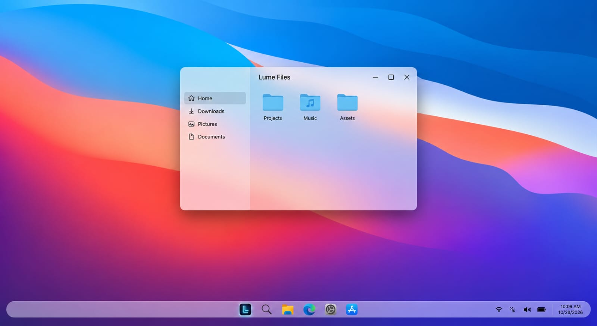

# Lume OS

SO Linux leve, premium e imutável — construído para devolver vida a PCs fracos e rodar em pendrive persistente, RAM ou HD. Visual premium em 3 edições detectadas por hardware: **Lite (i386)**, **Core** e **Prime (amd64)**.



> A imagem acima mostra a experiência visual alvo: desktop limpo, barra pílula inferior, janelas de vidro flutuando (CSD QML), relógio e indicadores na barra, e o gerenciador de arquivos Lume Files com interface de vidro (blur + materiais). Os wallpapers usados no produto final são os do pack **Lume Wallpapers** (design/wallpapers-gen), não a imagem de referência.

---

## 🎯 O que é o Lume OS

O **Lume OS** é um sistema operacional Linux leve, imutável na base e com visual premium (estrutura inspirada no Windows 11 com física e materiais inspirados no macOS). Desenvolvido em **Rust** para os serviços do sistema e **Qt6/QML** para a interface, ele roda em computadores fracos, pendrives persistentes, RAM ou HD — com ~1/5 do consumo de RAM do Windows 11.

> **Versão:** CalVer 2026.11 (Release 0.1)  
> **Status:** Construído nas fases 0–22 do roadmap (monorepo)  
> **Línguas:** pt-BR e en-US  
> **Licença:** MIT (código próprio), componentes upstream mantêm suas licenças

---

## 🖥️ Como o Lume OS se parece

A interface segue a filosofia **"Vidro calmo sobre luz"**: desktop limpo, uma barra pílula inferior, janelas de vidro flutuando, movimento de mola e nada gritando.

| Componente | Descrição |
|------------|-----------|
| **Barra pílula** | 48 px, margem 8 px, ícones 28 px, dot de notificação, hover lift, overflow com chevron |
| **Menu Iniciar** | 640×560, busca no topo, grid 6×3, recentes, rodapé usuário+energia |
| **Flyouts** | 4 painéis (redes, quick settings, volume, calendário+notificações), raio 16, vidro, abrem <150 ms |
| **Janelas** | Vidro + sidebar tingida, raio 12, titlebar 40 px com controles à direita, sombra 2 camadas, abrir com escala .96→1 (mola) |
| **Alt+Tab / Overview** | Thumbnails centralizados, 4 layouts de snap no hover do maximizar |
| **Greeter / Lock** | Wallpaper escurecido+blur, relógio grande, avatar central, senha em pílula |
| **OOBE** | Cartão central de vidro: idioma, teclado, rede, usuário, criptografia, tier, Essenciais |

> Todos os wallpapers são **originais** (pack Aurora Lume e variantes), sem uso de assets da Apple ou Microsoft.

---

## 🚀 Como usar / Como instalar

### 1. Baixar a ISO
Acesse a seção de **Releases** deste repositório e baixe a ISO adequada ao seu hardware:

| Edição | Arquitetura | Alvo | Tamanho |
|--------|-------------|------|---------|
| **Lite** | i386 (PAE) | P4, 1–2 GB, GPU 2004–2009 | ≤ 900 MB |
| **Core** | amd64 | <4 GB ou GPU sem GLES3.2 | ≤ 1,4 GB |
| **Prime** | amd64 | ≥4 GB + GLES3.2 | ≤ 1,4 GB |

### 2. Criar pendrive de instalação
Use **Rufus**, **Etcher** ou **Ventoy** para gravar a ISO em um pendrive (mínimo 8 GB, recomendado 16 GB+).

### 3. Instalar no computador
1. Inicie o computador pelo pendrive (ajuste a ordem de boot na BIOS/UEFI se necessário).
2. No **OOBE** (Primeira Execução), configure:
   - Idioma e teclado (ABNT2 automático para pt-BR)
   - Rede (Wi-Fi ou cabo)
   - Usuário e senha
   - Criptografia de disco (LUKS2 recomendada)
   - Tier (Lite/Core/Prime) — ou deixe a detecção automática escolher
   - Pacote Essenciais (1 clique)
3. O instalador (Calamares branded) fará:
   - Particionamento EFI (512 MB) + `LUME-BOOT` (slots A/B SquashFS+verity) + `LUME-DATA` (LUKS2 ext4)
   - Instalação do sistema base imutável
   - Configuração do GRUB assinado (shim) com A/B rollback
4. Reinicie e remova o pendrive.

> **Nota:** O Lume OS não usa `dd`, `parted` ou `mkfs` diretamente em discos reais do usuário durante o desenvolvimento; todas as operações de disco são feitas via imagens loop e QEMU em ambiente de desenvolvimento controlado.

---

## 🧠 O que tem no SO

### Sistema base
- Base imutável **SquashFS + verity** (slots A/B para atualização com rollback automático)
- Persistência **LUKS2** (`LUME-DATA`)
- Base Debian (12 i386 para Lite, 13 amd64 para Core/Prime)
- systemd, PipeWire/WirePlumber, NetworkManager, bluez, logind, power-profiles-daemon
- zram (swap com zstd), hibernação desligada por padrão

### Shell e interface
- **Shell Quickshell** (Qt6/QML) com barra pílula, menu iniciar, flyouts, toasts, overview, alt-tab, snap
- **Lite host** (X11 + picom) para hardware fraco
- **libdecor Lume** para janelas terceiras (CSD QML, titlebar 40 px, cantos arredondados, sombra 2 camadas)
- Atalhos completos: Super (menu), Super+E (files), Super+I (settings), Super+L (lock), Super+D (desktop), Super+Tab (overview), Alt+Tab, Print, Ctrl+Alt+T (terminal), Super+` (quake terminal)

### Aplicativos do sistema
| App | Função |
|-----|--------|
| **Files** | Toolbar, breadcrumb editável, abas, busca (rg), grade/lista, sidebar, drag-drop, extração p7zip, montagem udisks2 |
| **Settings** | 16 páginas espelhando o Windows 11 |
| **Store** | 8 categorias, badges tier, fila, updates separado, aba garrafas |
| **Terminal** | foot (Wayland) / xfce4-terminal (Lite), bash+starship+fzf+zoxide, abas, quake |
| **Task Manager** | Árvore /proc, gráficos CPU/RAM/GPU, matar processos |
| **Security Center** | Checklist Shield, firewall, sandbox inspector, launcher Cofre |
| **Updates** | Canal, checagem, progresso, reiniciar, rollback, histórico |
| **Editor / Viewer / PDF / Calc** | Leves, QML, MIME defaults |
| **Screenshot** | Tela, região, janela, gravação (Prime) |
| **Welcome / Backup / Bottles** | Tour, backup LUKS, garrafas bwrap |
| **Greeter / Lock** | Login + lock com prompt LUKS via Plymouth |
| **CLI `lume`** | update, shield, tier, store, fetch, session |

### Pré-instalados
Firefox ESR, VLC, p7zip e o **Pacote Essenciais** (OOBE 1 clique): OnlyOffice, WhatsApp PWA, Spotify/Discord/Zoom/Steam por tier, Teams PWA, Brave opcional.

---

## 🛡️ Diferenças e diferenciais

| Recurso | Lume OS | Windows 11 | Linux típico |
|---------|---------|------------|--------------|
| **Idle RAM** | 250–450 MB | 2–4 GB | 500 MB–1 GB |
| **Base imutável** | ✅ SquashFS+verity | ❌ | ❌ (geralmente) |
| **Update A/B com rollback** | ✅ | ⚠️ Limitado | ❌ (geralmente) |
| **Persistência LUKS2 em pendrive** | ✅ | ❌ | ⚠️ Limitado |
| **3 edições por hardware** | ✅ (Lite/Core/Prime) | ❌ | ❌ |
| **Sem telemetria** | ✅ | ❌ | ✅ (geralmente) |
| **Isolamento (loja/garrafas/cofre)** | ✅ 3 níveis | ❌ | ⚠️ Parcial |
| **Visual premium (vidro, mola, materiais)** | ✅ | ⚠️ Parcial | ❌ |

### Isolamento em 3 níveis
1. **Loja:** Flatpak com presets por categoria
2. **Windows:** Garrafas **bwrap** com pasta única compartilhada
3. **Modo Cofre:** microVM **cloud-hypervisor** descartável (só Prime ≥8 GB) — abre app de risco e destrói sem deixar resíduo

### Segurança (Lume Shield)
- LUKS2 padrão (USB + HD)
- Verity nos slots
- Secure Boot + lockdown=integrity (B/C)
- AppArmor enforce, seccomp nos daemons
- nftables default-deny entrada
- Zero telemetria (crash local opt-in)
- TPM2 opcional (desligado por padrão)

---

## 🏗️ Arquitetura técnica

```
QML (shell/apps) ⇄ D-Bus ⇄ Daemons Rust ⇄ systemd/Debian
```

### Serviços Rust
| Serviço | Função |
|---------|--------|
| `lume-detect` | Classifica tiers (CPU/RAM/GPU/VA-API/VM) no boot |
| `lume-updated` | Update A/B com rollback via GitHub Releases |
| `lume-shield` | Central de Segurança (checklist Shield, firewall, sandbox) |
| `lume-filesd` | Daemon de arquivos (montagem, extração, lixo) |
| `lume-stored` | Armazenamento imutável (SquashFS+verity) |
| `lume-cli` | CLI completa (`lume update`, `lume shield`, `lume tier`, `lume store`, `lume fetch`, `lume session`) |

### CLI `lume`
```bash
lume update        # verificar, baixar, aplicar, rollback
lume shield        # central de segurança
lume tier          # classificar, setar, override via OOBE
lume store         # instalar, remover, listar flatpak
lume fetch         # informação do sistema (hardware, tier, versão)
lume session       # gerenciar sessão, lock, desligar, reiniciar
```

### Comandos não encontrados
O `command-not-found` sugere pacotes para instalar via Flatpak quando você digita um comando não encontrado.

---

## 📊 Roadmap (28 fases)

O projeto segue 28 fases sequenciais com gates de erro (testes + blockers 0 + sign-off visual). Fases concluídas:

| Fase | Nome | Status |
|------|------|--------|
| 0 | Fundação + Mission Control | ✅ |
| 1 | Design system + assets | ✅ |
| 2 | ISO amd64 boot | ✅ |
| 3 | Daemons Rust + detect | ✅ |
| 4 | Barra/tray/relógio | ✅ |
| 5 | Flyouts | ✅ |
| 6 | Iniciar + busca | ✅ |
| 7 | Janelas/snap/overview | ✅ |
| 8 | Lume Files | ✅ |
| 9 | Settings parte 1 | ✅ |
| 10 | Settings parte 2 + Security | ✅ |
| 11 | Terminal + CLI | ✅ |
| 12 | Loja | ✅ |
| 13 | Essenciais + PWA + MIME | ✅ |
| 14 | OOBE + login + energia | ✅ |
| 15 | Instalador HD | ✅ |
| 16 | Pendrive persistente | ✅ |
| 17 | Edição Lite i386 | ✅ |
| 18 | Edição Core | ✅ |
| 19 | Camada Windows | ✅ |
| 20 | Jogos nuvem | ✅ |
| 21 | Shield hardening | ✅ |
| 22 | Modo Cofre | ✅ |
| 23 | Update A/B + GitHub | ⏳ |
| 24 | i18n + a11y | ⏳ |
| 25 | Passe performance | ⏳ |
| 26 | Suíte testes VM | ⏳ |
| 27 | Beta/release | ⏳ |

*Fases 23–27 estão em planejamento/execução conforme o roadmap.*

---

## 🤝 Como contribuir

O Lume OS é um monorepo desenvolvido em fases sequenciais. Se quiser contribuir:

1. **Faça um fork** do repositório
2. **Crie uma branch** a partir da fase atual
3. **Desenvolva** seguindo as especificações do PRD e VISION
4. **Teste** em VM QEMU (não use `dd`/`parted`/`mkfs` em discos reais)
5. **Abra um PR** descrevendo a fase e as mudanças

### Regras de ouro
- Não pular fases
- Gate de fim de fase: suíte de testes verde + blockers 0
- 3 falhas na mesma tarefa = bloqueada + alerta + seguir tarefas independentes
- Commits convencionais + tag `phase-N-done`
- Builds root só em container Podman
- Não assinar releases, não push externo, não guardar chaves
- Sessão limitada a 5 h (systemd timer)

---

## 📄 Licença

Código próprio: **MIT** (arquivo `LICENSE`).  
Componentes upstream mantêm suas licenças originais.  
Assets de marca: originais.  
**Proibido:** assets da Apple ou Microsoft (wallpapers, ícones, temas).

---

## 📞 Contato e suporte

- **Issues:** Abra uma issue no GitHub para bugs ou sugestões
- **Mission Control:** Acompanhe o desenvolvimento em tempo real (painel em `http://localhost:7777` durante o desenvolvimento)
- **Documentação:** `docs/PRD.md`, `docs/VISION.md`, `docs/MISSION-CONTROL.md`, `docs/OPEN.md`

---

> **Lume OS** — Devolvendo vida a PCs fracos, com visual premium e segurança por isolamento.  
> *CalVer 2026.11 • Release 0.1 • Monorepo*

---

*Documentação gerada a partir do monorepo Lume OS. Para a versão mais atualizada, consulte os arquivos em `docs/` e o roadmap ativo no repositório.*
